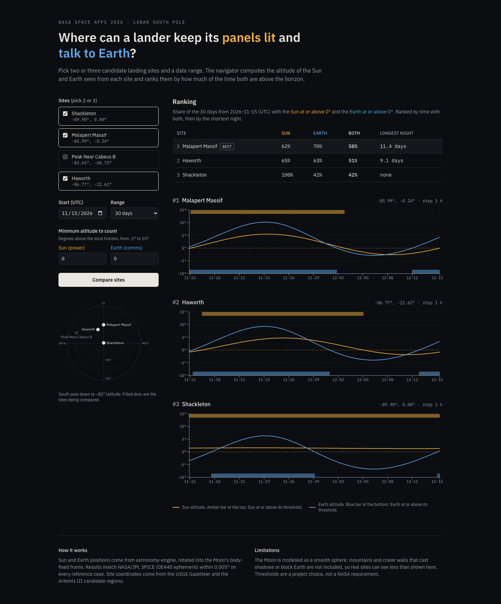
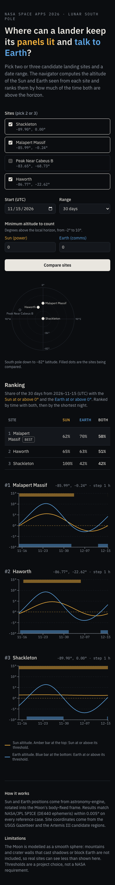

# Lunar Landing Site Navigator

NASA Space Apps Challenge 2026 project. It compares candidate landing sites near the lunar south pole by the Sun and Earth altitude over time, to find solar-power and direct-to-Earth communication windows.

**Live app:** https://lunar-landing-site-navigator-indol.vercel.app



## The problem

At the lunar south pole the Sun never rises far above the horizon. A lander needs sunlight on its panels for power, and needs Earth above the horizon to talk to it directly without a relay. Both change over a lunar day (about 29.5 Earth days). Earth also wobbles in the sky because of libration, and the Sun shifts with the lunar seasons. Two sites a few kilometres apart can differ a lot.

This app shows, for each candidate site and date range, how much of the time the Sun is up, Earth is up, and both are up at once. It also shows the longest stretch without Sun, which sets how much battery a lander would need.

## Using the app

1. Pick 2 or 3 sites, a start date (UTC), a range (7 days, 30 days, 90 days or 1 year) and the minimum altitude for the Sun and for Earth to count. The defaults are 0° for both, which means the centre of the disc is on the horizon.
2. Press **Compare sites**.
3. Read the **ranking table**:
   - **Sun:** share of the time with the Sun at or above its threshold.
   - **Earth:** share of the time with Earth at or above its threshold.
   - **Both:** share of the time with both at once.
   - **Longest night:** the longest stretch without Sun inside the range.

   Sites are ranked by **Both**, then by the shorter longest night.

4. Read the **charts**, one per site, all on the same vertical scale. The amber line is the Sun's altitude and the blue line is Earth's. Bars mark the windows above threshold: amber along the top for the Sun, blue along the bottom for Earth.

Every comparison is a shareable URL. For example, Malapert Massif and Haworth over one year with a 1° Sun threshold:

```
/?site=malapert_candidate&site=haworth_candidate&start=2026-11-15&days=365&sun=1&earth=0
```

| Parameter | Values                                 | Default                                   |
| --------- | -------------------------------------- | ----------------------------------------- |
| `site`    | 2 or 3 site ids (repeat the parameter) | Shackleton, Malapert Massif, Haworth      |
| `start`   | `YYYY-MM-DD`, UTC                      | today                                     |
| `days`    | `7`, `30`, `90`, `365`                 | `30` (hourly samples; 6-hourly for `365`) |
| `sun`     | −2 to 10 (degrees)                     | `0`                                       |
| `earth`   | −2 to 10 (degrees)                     | `0`                                       |

An invalid value falls back to its default, and the page shows a message saying so.

The app also works on phones:



## Stack

- Next.js 16 (App Router, Cache Components) + TypeScript + Tailwind CSS
- [astronomy-engine](https://github.com/cosinekitty/astronomy) 2.1.19 for ephemeris vectors
- Recharts 3.10.1 for charts
- Vitest for unit tests
- ESLint + Prettier
- Deploys on Vercel

## Run locally

```bash
npm install
npm run dev        # http://localhost:3000
```

## Scripts

| Script                 | What it does                      |
| ---------------------- | --------------------------------- |
| `npm test`             | Run unit tests once               |
| `npm run test:watch`   | Run tests in watch mode           |
| `npm run lint`         | ESLint                            |
| `npm run typecheck`    | Generate Next types and run `tsc` |
| `npm run format`       | Format with Prettier              |
| `npm run format:check` | Check formatting                  |
| `npm run build`        | Production build                  |

## Method

`altitudesAt(site, instant)` in [`src/lib/altitude.ts`](src/lib/altitude.ts) returns the Sun and Earth altitude in degrees seen from a site on the Moon.

1. Get geometric vectors (no light-time correction) from astronomy-engine. Moon→Sun is `HelioVector(Body.Moon)` negated, and Moon→Earth is `GeoMoon` negated.
2. Rotate them from J2000 equatorial into the lunar body-fixed frame, using the IAU 2015 rotation model (`RotationAxis(Body.Moon)`). Its `ra` is in sidereal hours, so it is multiplied by 15.
3. Place the site on a sphere of radius 1737.4 km (latitude, longitude positive east) and subtract it.
4. The altitude is the angle above the local horizontal plane, whose normal is the sphere normal at the site.

astronomy-engine's `Observer` is not used, because it only models observers on Earth.

**From altitudes to scores** ([`src/lib/windows.ts`](src/lib/windows.ts), [`src/lib/scoring.ts`](src/lib/scoring.ts), [`src/lib/comparison.ts`](src/lib/comparison.ts)):

1. `altitudeSeries` samples `altitudesAt` over the range: hourly up to 90 days, every 6 hours for one year.
2. `findWindows` finds the stretches where an altitude is at or above its threshold. The edges are placed by linear interpolation between samples, so they do not snap to the sampling step.
3. `scoreSite` adds up the window durations to get each fraction, and takes the longest gap between Sun windows as the longest night.
4. `compareSites` runs this for each site and returns the sites best first.

The page runs all of this on the server. The browser only draws the result: the chart component does no calculation.

## Validation

**Reference.** [`notes/reference_altitudes.json`](notes/reference_altitudes.json) holds 32 rows: 4 sites, Nov 14–15 2026, every 6 hours. They were generated with SPICE (spiceypy 8.4.0, CSPICE N0067) in the `MOON_ME` frame, on the same 1737.4 km sphere and without light-time correction. The file records the SHA-256 of each kernel.

**Tolerance: 0.005°** for both Sun and Earth altitude. This is a project decision and has not been confirmed by NASA. It is about 10 times the worst difference between two independent SPICE implementations of the same setup (0.00037°).

**Results.**

| Check                                                     | Max Sun diff | Max Earth diff | Over tolerance |
| --------------------------------------------------------- | ------------ | -------------- | -------------- |
| 32 reference rows (`npm test`)                            | 0.00115°     | 0.00067°       | 0              |
| 200 random SPICE cases, 2020–2035 (one-off check, Nov 14) | 0.0032°      | 0.0037°        | 0              |

The 200-case check used 150 south-polar sites (latitude −90° to −80°) and 50 sites anywhere on the Moon. The difference does not grow over those years. It varies between about 0.001° and 0.004°, which fits the gap between the IAU rotation model and the `MOON_ME` frame. Plan for a worst case of about 0.004°. This check is not yet part of `npm test`.

**SPICE kernels.** The kernels are not in the repository because of their size. To regenerate the reference, download them into `notes/` from [NAIF generic kernels](https://naif.jpl.nasa.gov/pub/naif/generic_kernels/):

- `lsk/naif0012.tls`
- `pck/pck00011.tpc`
- `spk/planets/de440.bsp` (about 120 MB)
- `pck/moon_pa_de440_200625.bpc`
- `fk/satellites/moon_de440_250416.tf`

Then install spiceypy and run the generator script, [`scripts/build_reference_v3.py`](scripts/build_reference_v3.py):

```bash
python3 -m venv .venv
.venv/bin/pip install spiceypy==8.4.0
.venv/bin/python scripts/build_reference_v3.py   # overwrites notes/reference_altitudes.json
```

Re-running it reproduces all 32 rows, the sites and the kernel hashes exactly. Only `generated_utc` and the formatting change, so run `npm run format` afterwards.

## Sites

All four are provisional. Sources and open items are listed in the reference file.

| Id                             | Latitude | Longitude | Source                                                         |
| ------------------------------ | -------- | --------- | -------------------------------------------------------------- |
| `shackleton_rim`               | −89.900° | 0.000°    | USGS Gazetteer, feature 5450 (control network 3)               |
| `malapert_candidate`           | −85.987° | −0.237°   | Artemis III candidate region centre, USGS DOI 10.5066/P1MEQ6UK |
| `peak_near_cabeus_b_candidate` | −83.651° | −68.726°  | Artemis III candidate region centre, USGS DOI 10.5066/P1MEQ6UK |
| `haworth_candidate`            | −86.766° | −22.620°  | Artemis III candidate region centre, USGS DOI 10.5066/P1MEQ6UK |

## Limitations

- **Smooth sphere, no terrain.** Mountains and crater walls are not modelled, so a site may be in shadow, or have Earth blocked, when this model says otherwise. At the south pole, terrain strongly affects real illumination. For example, Shackleton has the Sun above the horizon 100% of the time in this model.
- **IAU rotation model.** The app's lunar frame differs from SPICE's `MOON_ME` by up to about 0.004° in altitude.
- **Not NASA-confirmed.** The 0.005° tolerance and the choice of frame are project decisions.
- **Haworth.** The candidate region does not contain the crater centre. Whether to use the region or the crater is still open.
- **Sampling.** Window edges are interpolated between samples taken every 1 hour (or 6 hours for one year). A window shorter than one step can be missed.
- **Range edges.** A night that starts before the range, or ends after it, is cut at the range edge. The longest night can therefore be longer in reality.
- **Point sites.** Each site is a single point. The Artemis III candidate regions span several kilometres.

## Next steps

- Add terrain from LOLA elevation models (for example, horizon masks per site) so that shadows from nearby mountains and crater walls count.
- Use the solar disc instead of its centre, so that a partly risen Sun gives partial power.
- Let users enter their own coordinates, and compare several points inside one candidate region.
- Add the 200 random SPICE cases to `npm test`.
- Confirm the tolerance, the reference frame and the useful altitude thresholds with NASA experts.

## Use of AI

AI tools helped write this project. The author directed the work and made the key decisions:

- the calculation method, which the author had already measured against SPICE before asking an AI to implement it;
- the reference frame, the sites and the 0.005° tolerance;
- the scoring metric and the defaults.

| Tool                          | What it did                                                                                                                                                                    |
| ----------------------------- | ------------------------------------------------------------------------------------------------------------------------------------------------------------------------------ |
| DeepSeek                      | First draft of the SPICE calculation. The author fixed it by hand until it ran, and checked it against a second implementation (0.00037° apart).                               |
| Claude (sandbox session)      | The script that builds the SPICE reference table, [`scripts/build_reference_v3.py`](scripts/build_reference_v3.py). The author reviewed and chose the sites and the tolerance. |
| Claude Code (Claude Opus 5.5) | The TypeScript calculation, windows, scoring, comparison and user interface, the tests, this README and the Vercel setup, step by step at the author's request.                |

All AI-written calculation code is checked by tests against an independent reference generated with NASA/JPL SPICE. Every step, with what was asked and what a human checked, is in [`notes/ai-usage-log.md`](notes/ai-usage-log.md).

## Folders

- `src/app` – the Next.js page; `src/app/ui` holds its components
- `src/lib` – pure calculation code and its tests
- `docs/screenshots/` – screenshots used in this README
- `scripts/` – SPICE reference table generator (Python, not part of the app)
- `notes/` – reference data, research notes and the [AI usage log](notes/ai-usage-log.md)
